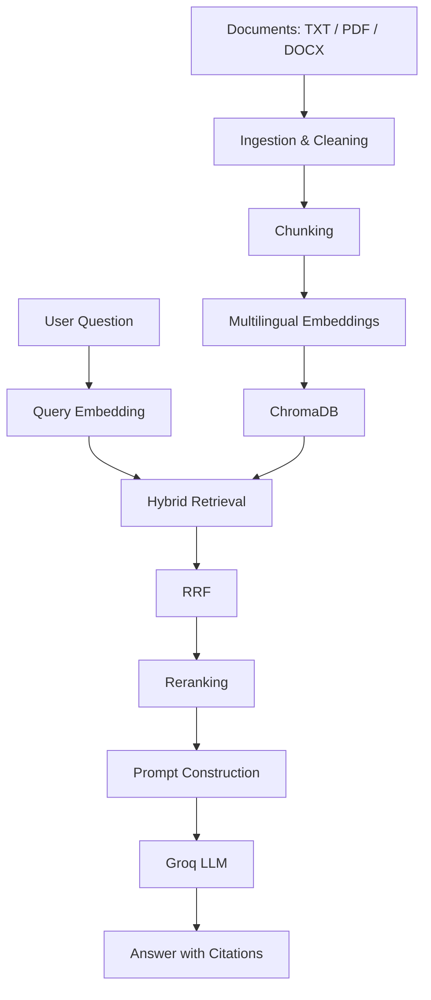

# Multilingual RAG System

A multilingual Retrieval-Augmented Generation (RAG) system that answers questions using information retrieved from documents. It combines multilingual embeddings, hybrid retrieval, reranking, and LLM-powered answer generation.

Built with **FastAPI**, **ChromaDB**, **Sentence Transformers**, and **Groq**.

## Features

- **Document ingestion:** Supports TXT, PDF, and DOCX files.
- **Text processing:** Cleaning and overlapping chunking.
- **Multilingual embeddings:** BAAI/bge-m3.
- **Vector storage:** Persistent ChromaDB.
- **Hybrid retrieval:** Semantic search and BM25 keyword search with Reciprocal Rank Fusion (RRF).
- **Reranking:** Cross-encoder-based relevance ranking.
- **Answer generation:** Groq LLM with grounded prompts and multilingual responses.
- **Abstention:** Avoids answering when information is not available in the retrieved context.
- **Evaluation:** Retrieval metrics and LLM-as-a-Judge generation evaluation.
- **Observability:** API request/error logging and component-level latency measurements.
- **REST API:** FastAPI with interactive Swagger documentation.
- **Docker:** Containerized API.

## Architecture



## Tech Stack

| Component | Technology |
|---|---|
| Language | Python |
| Embeddings | Sentence Transformers (BAAI/bge-m3) |
| Vector Database | ChromaDB |
| Keyword Retrieval | BM25 |
| Reranking | Cross-Encoder |
| LLM | Groq API |
| API | FastAPI |
| Evaluation | Retrieval metrics, LLM-as-a-Judge |
| Containerization | Docker |

## Project Structure

```text
multi-lingual-RAG/
├── data/
│   ├── raw/
│   ├── processed/
│   ├── evaluation/
│   └── vector_db/
├── src/
│   ├── ingestion/
│   ├── chunking/
│   ├── embeddings/
│   ├── retrieval/
│   ├── reranking/
│   ├── generation/
│   ├── evaluation/
│   └── api/
├── results/
├── tests/
├── notebooks/
├── config/
├── Dockerfile
├── requirements.txt
└── README.md
```

## Getting Started

### 1. Clone the repository

```bash
git clone https://github.com/Aagashaaa/multi-lingual-RAG.git
cd multi-lingual-RAG
```

### 2. Create a virtual environment

```bash
python -m venv .venv
```

Windows PowerShell:

```powershell
.venv\Scripts\Activate.ps1
```

### 3. Install dependencies

```bash
pip install -r requirements.txt
```

### 4. Configure environment variables

Create a `.env` file:

```env
GROQ_API_KEY=your_groq_api_key
```

### 5. Add documents

Place TXT, PDF, or DOCX files in `data/raw/`.

Documents must be processed and indexed into ChromaDB before the API can retrieve information. The API does not automatically ingest documents at startup.

## Run the API

```bash
python -m uvicorn src.api.app:app --reload
```

Open Swagger documentation:

`http://127.0.0.1:8000/docs`

### API Endpoint

`POST /ask`

Example request:

```json
{
  "question": "How many annual leave days do employees receive?",
  "answer_language": "English"
}
```

The response includes the generated answer and source citations.

## Evaluation

### Retrieval Evaluation

Evaluated using five question cases.

| Metric | Result |
|---|---:|
| Hit Rate@3 | 100% |
| Precision@3 | 33.33% |
| Recall@3 | 100% |
| MRR@3 | 90% |
| NDCG@3 | 92.62% |
| Source Hit Rate | 100% |

Run:

```bash
python -m src.evaluation.evaluate_rag
```

### Generation Evaluation

Evaluated using 10 test cases: six answerable and four unanswerable questions.

| Metric | Result |
|---|---:|
| Overall Pass Rate | 100% |
| Correctness | 5/5 |
| Faithfulness | 5/5 |
| Relevance | 5/5 |
| Keyword Coverage | 78.33% |

Evaluation includes keyword coverage, LLM-as-a-Judge scoring, and language compliance.

Run:

```bash
python -m src.evaluation.evaluate_generation
```

Results are saved in `results/`.

**Note:** These are initial results from a small evaluation dataset and a sample policy document. The LLM judge uses the same provider/family as the generator, which may introduce evaluation bias. These results should not be interpreted as production-level accuracy.

## Observability

The API includes:

- Request and error logging.
- Retrieval, reranking, and generation latency measurements.
- Total request processing time.

This provides basic application-level observability; centralized monitoring, distributed tracing, and alerting are not currently implemented.

## Limitations & Future Improvements

- Expand evaluation across more documents, languages, and questions.
- Explore multilingual reranking models.
- Improve chunking with sentence-aware strategies.
- Introduce independent evaluation models.
- Add automated tests and API authentication.
- Consider production deployment and centralized monitoring.

## License

No license has been specified for this project.